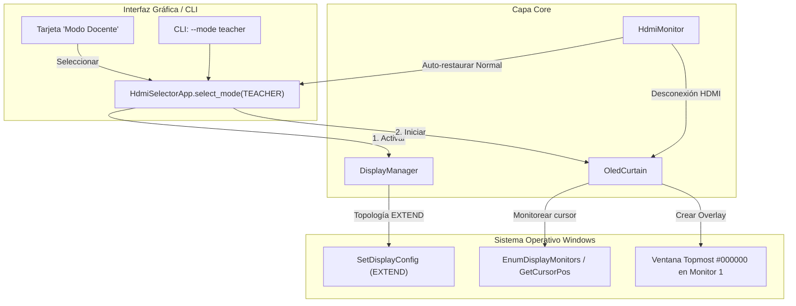

# Especificación Técnica: Modo Docente con Telón Negro Inteligente OLED

**Fecha**: 2026-09-24  
**Proyecto**: HDMI Selector & OLED Saver  
**Estado**: Aprobado por el usuario (En especificación)

---

## 1. Contexto y Problema

El usuario utiliza su laptop (con panel OLED) conectada por HDMI a un proyector o pantalla secundaria en un entorno de enseñanza / aula de clases.

### Limitaciones de los modos actuales:
- **Modo Presentación (`presentation`)**: Aplica `SDC_TOPOLOGY_EXTERNAL` (solo proyector). Esto apaga la pantalla de la laptop a nivel de señal de Windows, pero como consecuencia Windows mueve todas las aplicaciones (incluyendo notas y hojas de cálculo confidenciales de Excel con calificaciones) al proyector frente a los estudiantes, impidiendo consultar notas en privado.
- **Modo Ejercicios (`exercises`)**: Aplica `SDC_TOPOLOGY_EXTEND`. Mantiene ambas pantallas encendidas todo el tiempo, lo que expone el contenido privado en la laptop a miradas indiscretas y desgasta el panel OLED innecesariamente.

### Requerimiento:
Un **Modo Docente / Clase interactiva** que:
1. Mantenga el escritorio extendido (`SDC_TOPOLOGY_EXTEND`) para que las diapositivas se proyecten continuamente sin interrupciones.
2. Mantenga la pantalla de la laptop en reposo cubierta por un telón negro puro (`#000000`). En pantallas OLED, `#000000` apaga los píxeles físicamente (0 luz, 0 consumo, 0 riesgo de quemado).
3. Despierte **únicamente** cuando el cursor del ratón entra y se mueve en la pantalla de la laptop (ignorando clics y movimientos del mouse o clicker en el proyector).
4. Vuelva a cubrirse de negro automáticamente tras un periodo de inactividad configurable (30 segundos por defecto, con opciones de 15s, 30s, 1 min).
5. Se integre como un 4to modo en la GUI (`ui/app.py`) y en la CLI (`main.py`).

---

## 2. Arquitectura de la Solución



---

## 3. Especificación de Componentes

### 3.1. `core/display_manager.py`
* Modificación de la enumeración `AppMode`:
  ```python
  class AppMode(str, Enum):
      PRESENTATION = "presentation"
      TEACHER = "teacher"
      EXERCISES = "exercises"
      NORMAL = "normal"
  ```
* En `DisplayManager.apply_mode(mode=AppMode.TEACHER, timeout_seconds=...)`:
  * Configura topología: `set_display_topology(SDC_TOPOLOGY_EXTEND)`.
  * Pausa el salvapantallas del sistema: `set_screensaver(active=False)`.
  * Retorna `{ "success": True, "mode": AppMode.TEACHER, "topology": "extend", "screensaver": False }`.

### 3.2. `core/config.py`
* Nuevo atributo en `AppConfig`:
  * `teacher_timeout_seconds: int = 30`
* Serialización y deserialización en `~/.hdmi_selector_config.json`.

### 3.3. `core/oled_curtain.py` (Nuevo Componente)
* **Clase `OledCurtain`**:
  * `__init__(timeout_seconds: int = 30, on_state_change: Optional[Callable[[bool], None]] = None)`
  * Métodos principales:
    * `start()`: Inicia el hilo en segundo plano que vigila la posición del cursor y crea/gestiona el telón.
    * `stop()`: Destruye el telón y finaliza el hilo de monitoreo.
    * `wake()`: Oculta el telón negro para revelar el escritorio y las ventanas de la laptop.
    * `blackout()`: Muestra el telón negro a pantalla completa sobre el monitor interno.
    * `is_blacked_out() -> bool`: Retorna el estado actual del telón.
  * **Detección de Monitores**:
    * Utiliza `ctypes.windll.user32.EnumDisplayMonitors` para identificar el monitor principal (laptop) y registrar su `rcMonitor: (left, top, right, bottom)`.
  * **Rastreador de Cursor**:
    * Consulta `GetCursorPos()`.
    * Si las coordenadas `(x, y)` pertenecen al rectángulo del proyector o pantalla secundaria: **no hace nada** (el telón permanece negro).
    * Si las coordenadas entran o se mueven dentro del rectángulo del monitor 1:
      * Si estaba en `blackout`: invoca `wake()`.
      * Reinicia el temporizador de inactividad (`last_activity_time = now`).
    * En cada ciclo, si `now - last_activity_time >= teacher_timeout_seconds` y el cursor no se ha movido en el monitor 1, invoca `blackout()`.
  * **Ventana del Telón**:
    * Fondo negro absoluto `#000000` (RGB 0,0,0).
    * `HWND_TOPMOST` para estar por encima de cualquier ventana.
    * `WS_EX_TOOLWINDOW` para no figurar en la barra de tareas ni en Alt+Tab.
    * Tecla de escape de emergencia / clic de rescate: cualquier clic o tecla dentro del monitor 1 fuerza `wake()`.

### 3.4. `ui/app.py`
* **Cuarta Tarjeta de Modo**:
  * Título: `Modo Docente (Clase interactiva)` 🎓
  * Descripción: *"Diapositivas al 100% en proyector (HDMI extendido). Pantalla OLED de laptop apagada; se enciende al pasar el mouse a la laptop para consultar Excel y vuelve a apagarse tras inactividad."*
  * Botón: *"Activar Modo Docente"*.
* **Control de Inactividad en Quick Settings**:
  * Menú desplegable: `[ 15 seg | 30 seg | 1 min ]` vinculado a `config.teacher_timeout_seconds`.
* **Manejo de Ciclo de Vida**:
  * Al seleccionar `AppMode.TEACHER`: inicia `OledCurtain`.
  * Al cambiar a cualquier otro modo (`NORMAL`, `EXERCISES`, `PRESENTATION`): detiene `OledCurtain`.
  * Al cerrar la ventana (`_on_closing`): detiene y limpia `OledCurtain`.
  * Al desconectarse el HDMI con auto-restauración activa: `HdmiMonitor` restaura `NORMAL` y detiene `OledCurtain`.

### 3.5. `main.py` (CLI)
* Ampliación de argumentos:
  * `--mode {presentation,teacher,exercises,normal}`
  * En `--status`: incluye `teacher_timeout_seconds` y estado del telón.

---

## 4. Casos Borde y Seguridad

1. **Desconexión física del HDMI**: Si se desenchufa el proyector en mitad de la clase, el telón se destruye automáticamente y la laptop vuelve a ser visible de inmediato sin dejar al docente a oscuras.
2. **Coordenadas de monitor múltiples y escalado DPI**: `OledCurtain` consulta `rcMonitor` real para adaptarse a pantallas con escalado DPI (125%, 150%, 200%) sin dejar bordes sin cubrir ni salirse al proyector.
3. **Pérdida de foco**: La ventana del telón no bloquea el foco del sistema una vez levantada; el docente puede hacer clic en Excel y tipear inmediatamente.
4. **Cierre forzado / crash**: Un bloque `finally` y manejador de salida garantizan la llamada a `stop()` del telón.

---

## 5. Estrategia de Pruebas Unitarias

* `tests/test_oled_curtain.py`:
  * Verificación de cálculo de coordenadas del monitor principal.
  * Verificación de despertar condicional (movimiento en monitor 1 despierta; movimiento en monitor 2 no despierta).
  * Verificación de re-apagado tras expiración de inactividad.
  * Verificación de detención y liberación de recursos.
* `tests/test_display_manager.py`:
  * Cobertura de `apply_mode(AppMode.TEACHER)` (retorno correcto, llamada a `SDC_TOPOLOGY_EXTEND`).
* `tests/test_config.py`:
  * Cobertura de carga y guardado de `teacher_timeout_seconds`.
* `tests/test_main.py`:
  * Cobertura de invocación de CLI con `--mode teacher`.
  * Corrección de aserción en `test_status_command_outputs_valid_json`.
